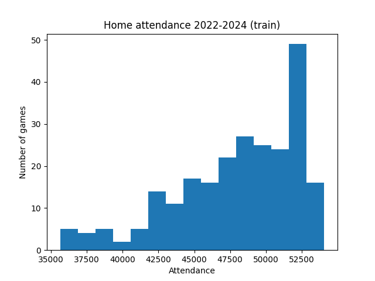
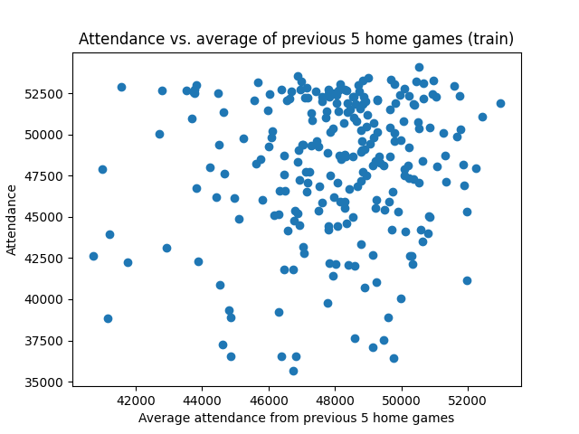
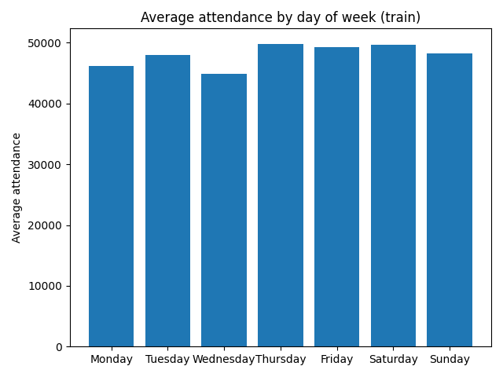

# Model Report for Predicting Los Angeles Dodgers Home Game Attendance

## Exploring the training data with 3 charts

Most (almost 150) home games in the 2022-2024 seasons drew crowds between 47,500 and 52,500 fans, close to Dodger Stadium's 56,000-seat capacity, with a relatively smaller number (less than 75) of games well below this range and about 15 games above this range.

Higher recent crowds go with only slightly higher attendance, whenever the recent average was above 44,000, most games clustered between 50,000 and 53,000 near capacity, with a handful of games below 40,000 appearing at almost every level of recent attendance.

Games later in the week, as expected, Thursday-Saturday drew the largest average crowds with all 3 days sitting close to 50,000 fans on average, while games earlier in the week drew slightly smaller crowds sitting closer to 45,000, Sunday was still higher than earlier week games but lower than other late week games and Tuesday was the highest attended eariler week day on average.

## Error measure: MAE

Attendance is a number, so every model is scored with MAE (mean absolute error): the average number of fans each guess is off by. The baseline guesses the 2022-2024 average attendance of 48,032 fans per game.

## Model comparison (validate rows, 2025)

| Model | Validate MAE | Better than baseline? |
|---|---|---|
| Baseline (train average) | 3,724 | — |
| Linear regression | 3,412 | Yes |
| Random forest | 3,838 | No |
| Gradient boosting | 3,858 | No |

## Model Chosen

I chose the linear regression model because it had the lowest validate MAE (3,412) and was the only model that beat the baseline, by about 312 fans per game (about 8%). The two tree models did worse than the baseline, they likely learned details of the 2022–2024 seasons that did not carry over to the 2025 season. Tree models also predict by averaging similar past games, so they keep predicting the earlier crowd levels when attendance continued to shift, while linear regression can adjust through features like recent attendance and win percentage. This again could be explained more by the World Series wins which overall boosted crowds in the 2025 and 2026 seasons each following one championship.

The gain over the baseline is relatively small because Dodger Stadium is near capacity for many of its games so there is limited variation for any model to predict meaning it is not a failure of the model.

## Test result (2026)

Trained on 2022–2024, then scored once on 2026:

| | MAE |
|---|---|
| Linear regression, validate (2025) | 3,412 |
| Linear regression, test (2026) | 2,500 |

The test error was actually lower than the validate error. One likely reason is that after back-to-back World Series titles in 2024 and 2025, demand stayed consistently high in 2026, so more games drew crowds near capacity and attendance varied less from game to game, which made it easier for the model to predict. That same high demand explains the model’s biggest misses, where it underestimated some weekday games that still drew over 50,000 fans even on Wednesdays. With only 81 games per season, some of the difference may also be chance.

## What the model learned

| Rank | Feature | Coefficient (fans) |
|---|---|---|
| 1 | dow_sun | +7,266 |
| 2 | dow_sat | +5,115 |
| 3 | opp_win_pct_before | +4,389 |
| 4 | dow_thu | +3,826 |
| 5 | dow_fri | +3,424 |

*Days of the week attendance are measured against Monday because it was the baseline day I chose to leave out of the model.*

**In business terms:** Day of the week is the strongest signal of attendance in this model. Compared with a Monday game, a Sunday game draws about 7,300 more fans and a Saturday about 5,100 more, with Thursday and Friday each adding roughly 3,500. Opponents who have a higher winning percentage also bring bigger crowds with +0.100 in opponent win % (for example .450 → .550) draws about 440 more fans. For staffing and parking, weekend games, especially Sundays, should be planned for the largest crowds as well as games against teams who are doing well in their own respective seasons.

## Limits of what the model can't do and what data would help most

- **No promotion or giveaway data:** Bobblehead nights, firework shows, and theme nights could explain many of the biggest misses for attendance. Knowing games with these types of promotions would probably help the most with explaining some of the outliers.
- **No ticket prices:** Knowing average ticket prices for games would show when demand is unusually high, especially for the weekday games which could continue to help dial in predictions.
- **Opponent appeal is only calculated by win %:** Team rivalries and other all-star players (like popular visiting pitchers or hitters or players who used to play for the Dodger's) also draw fans which is a factor I did not use in this project.
- **Use Dodgers Starting Pitcher as a feature:** I chose not to use probable starting pitcher as a feature for modeling as it is not numerical and may have made calculations more confusing with so many different possible pitchers but, same as above, it can help explain some fluctuation in attendance.
- **Small training set:** Only using 242 games for model training may limit more flexible models like the random forest, using more seasons of data may have helped make other models competitve for validation scores.
- **No weather data:** Another factor I could have considered in this prediction is weather as that affects many fans decisions to attend an outdoor event. I chose not to use this in this particular project as weather in LA fluctuates much less than in many other cities even year round.